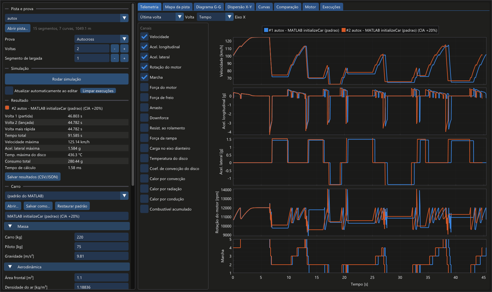
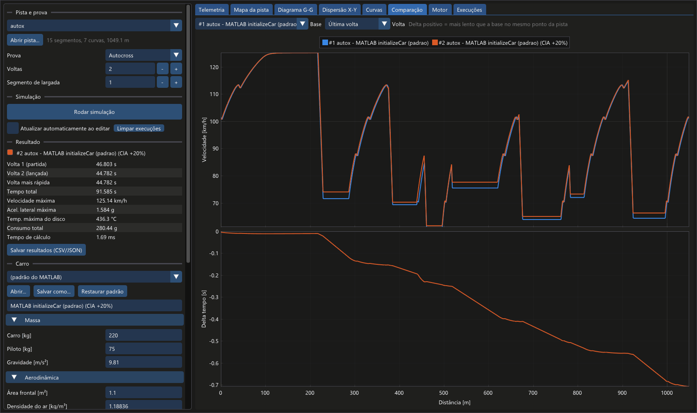
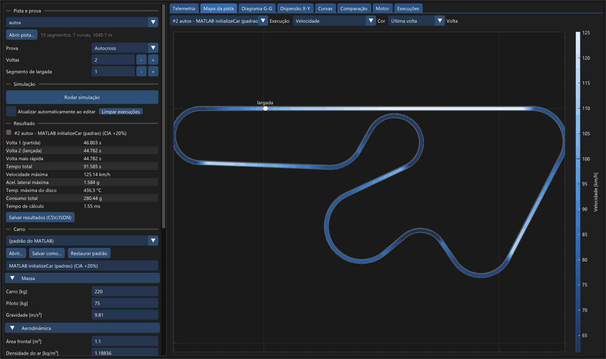

# fsae-lapsim

Simulador de tempo de volta para Formula SAE em C++17. É o port do simulador MATLAB
da equipe: um modelo de ponto de massa com transferência de carga, aerodinâmica, motor
com câmbio, temperatura do disco de freio e consumo de combustível por BSFC.

O port reproduz o MATLAB **bit a bit**: nas 5 pistas de referência, tempo total, tempos de
volta, velocidade máxima, aceleração lateral e consumo são idênticos aos do simulador
original, e roda cerca de **2.000 vezes mais rápido**.

São dois programas, os dois em C++:

- **`fsae_gui`**, a interface gráfica: edite o carro, escolha a pista, rode e veja a
  telemetria, o mapa da pista, o diagrama G-G, as curvas e a comparação entre setups;
- **`fsae_sim`**, a linha de comando: para rodar em lote, em scripts ou num otimizador.



*English summary: Formula SAE point-mass lap time simulator in C++17, ported from a MATLAB
simulator and validated against it bit for bit. Desktop GUI (Dear ImGui + ImPlot) to edit
the car, run and plot; command-line tool that writes CSV/JSON.*

| Pista | Voltas | Tempo (C++ = MATLAB) | MATLAB | C++ |
|---|---|---|---|---|
| Autocross | 2 | 47,492 s / 45,501 s | ~4,5 s | ~2 ms |
| Autocross 2024 V1 | 2 | 71,661 s / 70,113 s | ~3,8 s | ~2,8 ms |
| Autocross 2024 V1 (inverso) | 2 | 73,069 s / 71,668 s | ~3,6 s | ~2,6 ms |
| Skidpad | 1 | 6,240 s | ~0,4 s | ~0,08 ms |
| Aceleração | 1 | 4,250 s | ~0,3 s | ~0,14 ms |

Tempos medidos no computador de desenvolvimento (Windows 11); MATLAB R2026a, C++ com GCC 16 (`-O3`, build Release).

## Índice

- [Instalação](#instalação)
- [Interface gráfica](#interface-gráfica)
- [Uso rápido (linha de comando)](#uso-rápido-linha-de-comando)
- [Comandos](#comandos)
- [Arquivos de saída](#arquivos-de-saída)
- [Gráficos fora da interface](#gráficos-fora-da-interface)
- [O carro (JSON)](#o-carro-json)
- [Pistas](#pistas)
- [Comparar com dados reais](#comparar-com-dados-reais)
- [Validação contra o MATLAB](#validação-contra-o-matlab)
- [Usar como biblioteca](#usar-como-biblioteca)
- [Estrutura do projeto](#estrutura-do-projeto)
- [Limitações e próximos passos](#limitações-e-próximos-passos)

## Instalação

Requisitos: compilador C++17, CMake ≥ 3.20 e Ninja. Na primeira compilação o CMake baixa
as bibliotecas usadas, então é preciso internet:

- [nlohmann/json](https://github.com/nlohmann/json), para ler o JSON do carro;
- [doctest](https://github.com/doctest/doctest), para os testes;
- [GLFW](https://www.glfw.org), [Dear ImGui](https://github.com/ocornut/imgui) e
  [ImPlot](https://github.com/epezent/implot), para a interface.

### Windows (MSYS2)

```bash
winget install --id MSYS2.MSYS2 -e --source winget
```

No terminal **MSYS2 UCRT64**:

```bash
pacman -S --needed mingw-w64-ucrt-x86_64-gcc mingw-w64-ucrt-x86_64-cmake mingw-w64-ucrt-x86_64-ninja
```

Depois, adicione `C:\msys64\ucrt64\bin` ao PATH do Windows (ou rode os comandos abaixo no
próprio terminal UCRT64). Os executáveis gerados são estáticos: rodam em qualquer Windows
sem o MSYS2.

O código é C++ padrão. Em Linux e macOS basta instalar `cmake`, `ninja` e um compilador
(no Linux, também os pacotes de desenvolvimento do OpenGL/X11 para a interface).

### Compilar e testar

```bash
cmake --preset release
cmake --build --preset release
ctest --preset release
```

Os executáveis ficam em `build/release/apps/fsae_gui/fsae_gui.exe` (interface) e
`build/release/apps/fsae_sim/fsae_sim.exe` (linha de comando).

## Interface gráfica

Abra `fsae_gui.exe` com um duplo clique. Ele procura a pasta `data` (carros e pistas)
subindo a partir da pasta do executável. Se copiar o `.exe` para outro lugar, leve a pasta
`data` junto ou defina a variável de ambiente `FSAE_DATA_DIR`.

**Painel da esquerda, de cima para baixo:**

1. **Pista e prova:** escolha uma pista de `data/tracks` ou abra qualquer CSV
   (os três formatos da seção [Pistas](#pistas)), a prova, o número de voltas e o
   segmento de largada.
2. **Simulação:**
   - **Rodar simulação** (ou F5) guarda uma nova execução. Até 8 ficam guardadas, cada
     uma com sua cor, para comparar setups.
   - **Atualizar automaticamente ao editar** refaz a última execução a cada alteração:
     mude o Cl·A ou uma relação de marcha e veja o tempo mudar na hora.
3. **Resultado:** tempos de volta, máximos e consumo. **Salvar resultados** grava os mesmos
   arquivos da linha de comando (`telemetry.csv`, `summary.json`...).
4. **Carro:** todos os parâmetros do `initializeCar.m`, agrupados e com unidade:
   - massa, aerodinâmica, chassi e pneus;
   - transmissão, com uma tabela de marchas;
   - curvas de torque e BSFC, editáveis ponto a ponto;
   - freio e ar.

   Passe o mouse sobre um campo para ver o nome no MATLAB. **Abrir...** e
   **Salvar como...** leem e gravam o JSON do carro. Valores inválidos aparecem em
   vermelho e bloqueiam a simulação.

**Abas de gráficos.** Em todas dá para escolher a volta (última, todas ou uma
específica), dar zoom com a roda do mouse e arrastar.

| Aba | O que mostra |
|---|---|
| Telemetria | qualquer combinação de canais empilhados (velocidade, acelerações, rpm, marcha, forças, carga, temperatura e calor do disco, combustível) por tempo ou distância, para todas as execuções visíveis |
| Mapa da pista | a pista colorida por qualquer canal; passe o mouse para ler o valor |
| Diagrama G-G | aceleração lateral × longitudinal |
| Dispersão X-Y | qualquer canal contra qualquer outro |
| Curvas | velocidade-limite × velocidade real em cada curva, e tabela dos segmentos com o que limitou cada curva |
| Comparação | velocidade e diferença de tempo acumulada ao longo da pista, em relação a uma execução de base |
| Motor | torque, potência e BSFC do carro em edição, e rpm × velocidade em cada marcha |
| Execuções | tabela com todas as execuções: renomear, esconder, salvar, remover ou copiar o carro de volta para o editor |





## Uso rápido (linha de comando)

```bash
fsae_sim run --track autox
```

```
Resultados gravados em results/autox

----------------------------------------
Pista: autox (autocross, 2 voltas, 1049.05 m por volta)
Volta 1 (partida):      47.492 s
Volta 2 (lancada):      45.501 s
Volta mais rapida:      45.501 s
Tempo total:            92.992 s
Velocidade maxima:      125.19 km/h
Acel. lateral max.:      1.498 g
Temp. max. freio:        434.5 C
Consumo total:          278.73 g
  consumo volta 1:      145.23 g
  consumo volta 2:      133.50 g
----------------------------------------
```

Outros exemplos:

```bash
fsae_sim run --track skidpad
fsae_sim run --track acceleration --car meu_carro.json --out results/accel_setupB
fsae_sim run --track autox_2024_v1 --laps 5 --start-segment 10
fsae_sim run --track minha_pista.csv --event custom --verbose
fsae_sim run --track autox --json --no-files        # resumo em JSON na saída padrão
```

## Comandos

| Comando | O que faz |
|---|---|
| `run --track <pista> [opções]` | simula e grava os resultados |
| `list-tracks` | lista as pistas de `data/tracks` |
| `check-track <arquivo>` | valida uma pista e mostra número de segmentos, curvas e comprimento |
| `convert-track <entrada> <saída.csv> [comentário]` | converte uma pista (trackExcel/OptimumLap ou matriz do MATLAB) para o CSV do projeto |
| `gpx-slope <pista> <arquivo.gpx> <saída.csv>` | preenche a inclinação dos segmentos a partir da altitude de um GPX |
| `print-default-car` | imprime o carro padrão (`initializeCar.m`) em JSON |
| `check-car <arquivo.json>` | valida um JSON de carro |
| `version`, `help` | versão e ajuda |

Opções do `run`:

| Opção | Padrão | Descrição |
|---|---|---|
| `--track <arquivo\|nome>` | — | CSV da pista ou nome de uma pista de `data/tracks` |
| `--car <arquivo.json>` | carro do `initializeCar.m` | carro |
| `--event <prova>` | deduzido do nome da pista | `autocross`, `skidpad`, `acceleration` ou `custom` |
| `--laps <n>` | 2 em autocross/custom, 1 nas outras | número de voltas seguidas (a 1ª parte parada) |
| `--start-segment <k>` | 1 | a volta começa no segmento `k` |
| `--out <pasta>` | `results/<pista>` | onde gravar os arquivos |
| `--no-files` | — | só mostra o resumo |
| `--json` | — | imprime o `summary.json` na saída padrão (útil para otimizadores) |
| `--verbose` | — | relatório trecho a trecho, como o MATLAB |
| `--quiet` | — | não imprime o resumo |
| `--repeat <n>` | 1 | roda `n` vezes e mostra o tempo médio de execução |

O programa procura as pistas por nome em `$FSAE_DATA_DIR/tracks`, `./data/tracks` e em
`data/tracks` nas pastas acima do executável.

## Arquivos de saída

`fsae_sim run` grava em `--out`:

| Arquivo | Conteúdo |
|---|---|
| `telemetry.csv` | uma linha por amostra, com as mesmas colunas do `SimOut.History` do MATLAB (`time`, `distance`, `velocity`, `gear`, `acceleration`, `rpm`, `lateral_accel`, forças, `brake_temp`, `fuel_consumed_g`, `P_conv`, `P_rad`, `P_cond`, `load_front_dist`) mais `lap`. Unidades SI (m/s, m/s², N, W). |
| `summary.json` | tempos, consumo e máximos, por volta e com os nomes do `SimOut.Results` (`matlab_results`) |
| `track.csv` | segmentos usados (já com o segmento de largada) e a velocidade máxima de cada curva, indicando quando o limite foi tombamento |
| `geometry.csv` | traçado X/Y/Z (`buildTrack`) para gráficos |
| `car.json` | o carro usado |

Os números são gravados na menor forma decimal que reproduz o valor exato, então reler os
arquivos não perde precisão.

## Gráficos fora da interface

Opcional: os resultados gravados (`telemetry.csv` etc.) também abrem nos gráficos
originais do MATLAB ou num script Python.

**MATLAB** — os gráficos originais (`plotResults`) funcionam com o resultado do C++:

```matlab
addpath('tools/matlab')
plotCppResult('results/autox')        % última volta, como o runSimulation
plotCppResult('results/autox', 0)     % todas as voltas
SimOut = loadCppResult('results/autox');   % mesmo formato do SimOut do MATLAB
```

**Python** — `numpy` e `matplotlib`:

```bash
python tools/python/plot_results.py results/autox
python tools/python/plot_results.py results/autox --save figuras/
python tools/python/plot_results.py results/setupA --compare results/setupB
```

Gera telemetria vs. tempo, análise (velocidade vs. distância, diagrama G-G, mapas de
velocidade e marcha) e freio. Com `--compare`, mostra a velocidade e a diferença de tempo
acumulada ao longo da pista entre dois ou três resultados.

## O carro (JSON)

O carro padrão está em [`data/cars/default.json`](data/cars/default.json), gerado por
`fsae_sim print-default-car`. Para testar outra configuração, copie o arquivo, mude os
números e passe com `--car`; não é preciso recompilar.

Os valores entram nas unidades em que costumam ser medidos e a unidade faz parte do nome
(`cg_height_m`, `tire_radius_mm`, `shift_time_ms`, `cl_a_m2`). O programa converte para SI com
as mesmas contas do `initializeCar.m`. Grupos: `mass`, `aero`, `chassis`, `tyre`,
`powertrain`, `engine` (curvas de torque e BSFC), `brakes` e `air`.

A leitura é rigorosa: campo com nome errado, campo faltando, texto no lugar de número,
número de marchas diferente do número de rpm de troca, massa negativa etc. geram erro
com o caminho do campo, por exemplo:

```
Erro: JSON do carro: chassis.cg_heigth_m: campo desconhecido (validos: wheelbase_m, tire_radius_mm, ...)
```

## Pistas

Pistas são listas de segmentos (reta ou curva à esquerda/direita, com comprimento, raio e
inclinação). As pistas do MATLAB estão em [`data/tracks/`](data/tracks):

| Arquivo | Origem |
|---|---|
| `autox.csv` | `trackAutoX.m` |
| `autox_2024_v1.csv` | `track_AutoX_2024_V1.m` |
| `autox_2024_v1_reversed.csv` | `track_AutoX_2024_V1_reversed.m` |
| `skidpad.csv` | `trackSkidPad.m` |
| `acceleration.csv` | `trackAcceleration.m` |

Três formatos são aceitos, detectados automaticamente:

1. **CSV do projeto** (comentários com `#`):
   ```
   length_m,radius_m,slope,type
   228.05,0,0,straight
   57.551087148523706,28.08,0,right
   ```
2. **Matriz `segments` do MATLAB**, para colar direto do `.m`:
   ```
   index,length,radius,slope,type
   1,228.05,0,0,0
   2,57.551087148523706,28.08,0,2
   ```
   (`type`: 0 reta, 1 esquerda, 2 direita)
3. **trackExcel / OptimumLap**: `Tipo;Comprimento;Raio`, sem cabeçalho, inclinação zero.
   ```
   Left;1;83.875
   Straight;2.12;0
   ```

Erros apontam a linha (`Pista X, linha 12: curva (left/right) precisa de raio maior que 0`).

**Inclinação por GPX.** `fsae_sim gpx-slope pista.csv caminhada.gpx pista_com_slope.csv`
faz o mesmo que o `applyAltitudeFromGPX` do `Plot_GPX.m`:

1. suaviza a altitude;
2. acompanha o GPX pela distância percorrida;
3. interpola a altitude no início e no fim de cada segmento;
4. distribui o erro de fechamento da volta;
5. grava `atan(Δz/L)` em radianos.

O GPX precisa começar na largada e seguir o mesmo sentido dos segmentos.

## Comparar com dados reais

```bash
python tools/python/plot_results.py results/autox --log log_autox.csv
python tools/python/plot_results.py results/accel --log log_acceleration.csv --oplap Pista_Accel_OPLap.csv
```

```matlab
compareCppResult('results/autox', 'log_autox.csv')                 % plotComparison original
compareCppResult('results/autox', 'Pista_AutoX_OPLap.csv', 'oplap')
```

O log de aquisição é um CSV com cabeçalho. As colunas são reconhecidas pelo início do nome,
sem diferenciar maiúsculas nem acentos:

| Grandeza | Coluna começa com | Unidade |
|---|---|---|
| tempo | `TIME`, `TEMPO` | s |
| velocidade | `VELOCIDADE` | km/h |
| rpm | `RPM` | rpm |
| marcha | `MARCHA`, `Gear` | — |
| aceleração longitudinal | `Força_G_acelera`, `ACELERACAO_LONGITUDINAL` | g |
| aceleração lateral | `Força_G_lateral`, `ACELERACAO_LATERAL` | g |
| distância (opcional) | `DISTANCIA`, `Distance` | m |

A exportação do OptimumLap é lida a partir da seção `[Simulation Results]`.

## Validação contra o MATLAB

O simulador original fica em [`matlab/`](matlab) e não é modificado.
[`tools/matlab/export_reference.m`](tools/matlab/export_reference.m) roda o MATLAB e grava
em [`tests/reference/`](tests/reference) as entradas e saídas de cada função, de 10 retas
e das 5 pistas completas. Os testes (`ctest`) comparam o C++ com esses arquivos:

- quase tudo é **idêntico bit a bit** (tolerância zero), inclusive tempos, posições,
  velocidades, marchas, forças e consumo de todas as pistas;
- a única diferença conhecida é de 1 bit (~5e-16 relativo) no coeficiente de convecção
  do disco. O `pow` do MATLAB não é arredondado corretamente nesses casos, e isso não
  afeta o movimento do carro.

Detalhes em [`tests/reference/README.md`](tests/reference/README.md). Para regenerar:

```bash
matlab -batch "addpath('tools/matlab'); export_reference"
```

A correspondência entre cada função MATLAB e seu equivalente em C++ está em
[`docs/matlab_mapping.md`](docs/matlab_mapping.md).

## Usar como biblioteca

A física está na biblioteca `fsae::core`, separada do programa de linha de comando:

```cpp
#include "fsae/io/car_json.hpp"
#include "fsae/sim/lap.hpp"
#include "fsae/track/track.hpp"

const fsae::Car car = fsae::io::load_car("meu_carro.json");
const auto track = fsae::track::load_track("data/tracks/autox.csv");
fsae::sim::SimulationOptions opt;
opt.laps = 2;
const auto r = fsae::sim::simulate(car, track.segments, opt);
// r.lap_times, r.total_time, r.history.velocity, ...
```

Com `add_subdirectory` ou `FetchContent` no CMake, ligue a `fsae::core` (use
`-DFSAE_BUILD_TESTS=OFF -DFSAE_BUILD_APPS=OFF -DFSAE_BUILD_GUI=OFF` para compilar só a biblioteca).

## Estrutura do projeto

```
include/fsae/      cabeçalhos públicos
  vehicle/         carro e mapas do motor
  physics/         forças, cargas, motor/freio, temperatura do disco, passo de integração
  control/         câmbio
  track/           pistas, velocidade de curva, traçado, GPX
  sim/             reta e volta completa
  io/              CSV, JSON do carro, arquivos de resultado
src/               implementação
apps/fsae_gui/     interface gráfica (Dear ImGui + ImPlot)
apps/fsae_sim/     programa de linha de comando
tests/             testes (doctest) e dados de referência do MATLAB
tools/matlab/      geração das referências, leitura dos resultados e gráficos no MATLAB
tools/python/      gráficos em Python
data/cars/         carros
data/tracks/       pistas
data/private/      dados da equipe (logs, GPX, OptimumLap); fora do Git
matlab/            simulador MATLAB original (referência)
docs/              documentação e imagens
```

## Limitações e próximos passos

O port é **fiel** ao MATLAB, inclusive nos comportamentos que precisam ser melhorados (o
objetivo desta versão é garantir os mesmos resultados). Eles estão listados em
[KNOWN_ISSUES.md](KNOWN_ISSUES.md): inclinação tratada como porcentagem no cálculo das
curvas, velocidade zero em curvas de raio grande, rpm acima do limite nas reduções etc.

Planejado:

- correções dos problemas conhecidos, cada uma como opção e com o impacto medido;
- melhorias de física (acelerar e frear dentro das curvas, transição entre curvas);
- prova de endurance (autocross + 25 voltas — o número de voltas já é parâmetro);
- integração com otimizadores (modeFRONTIER) usando `--json`.

## Licença

MIT — veja [LICENSE](LICENSE).
