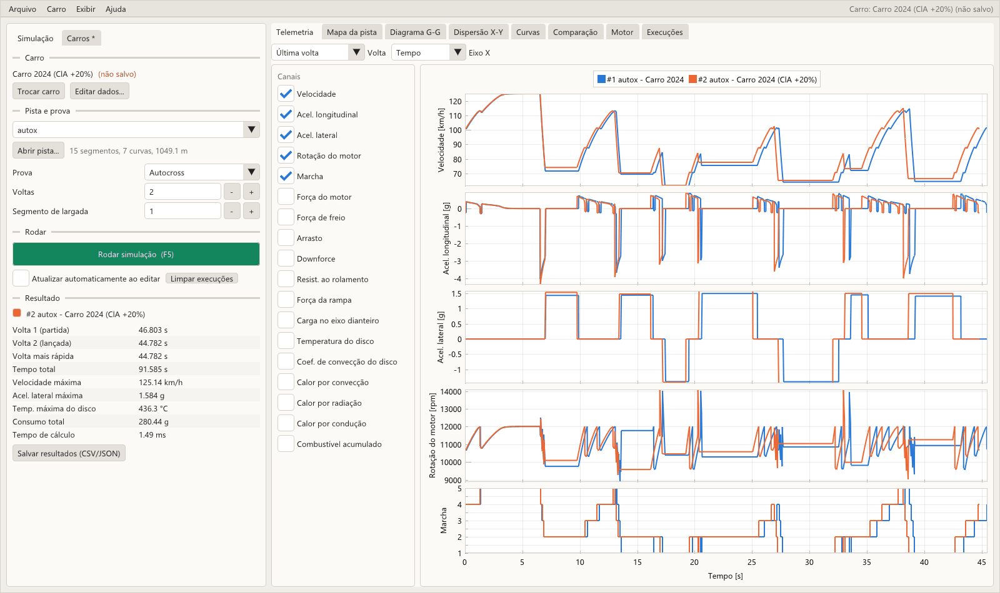
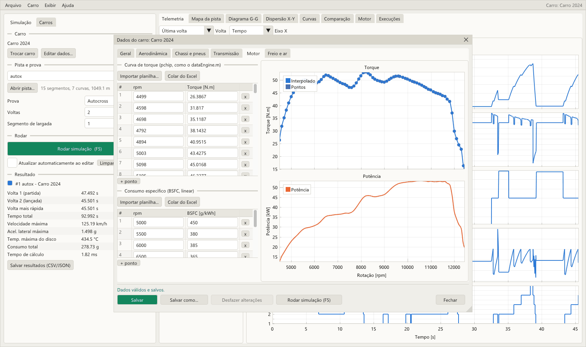
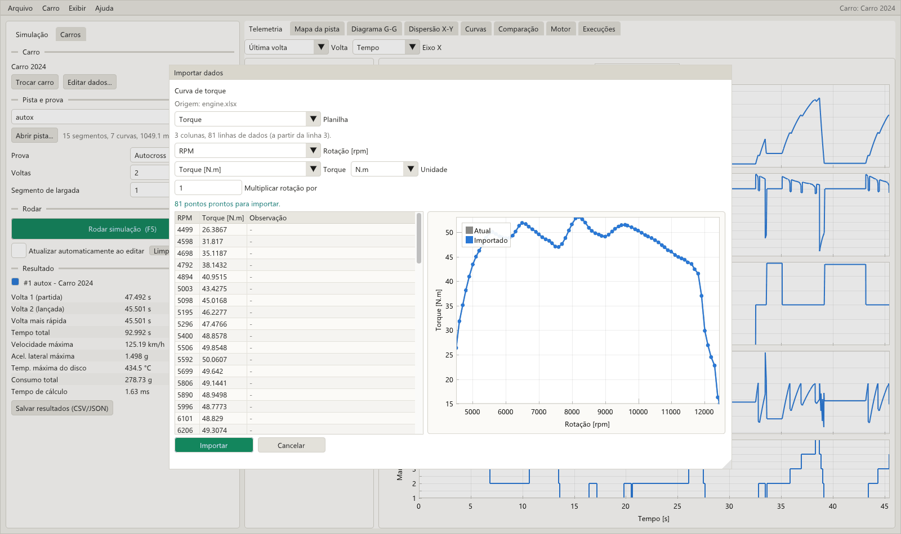
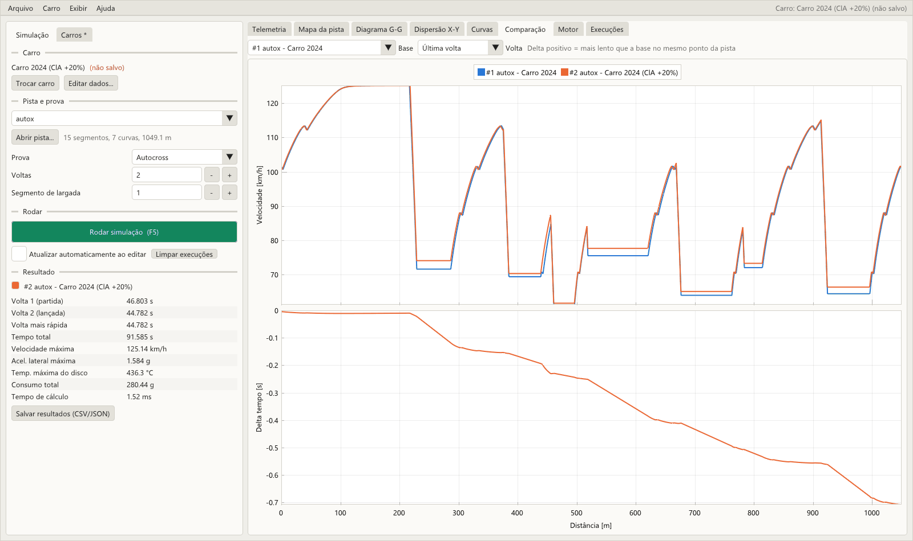
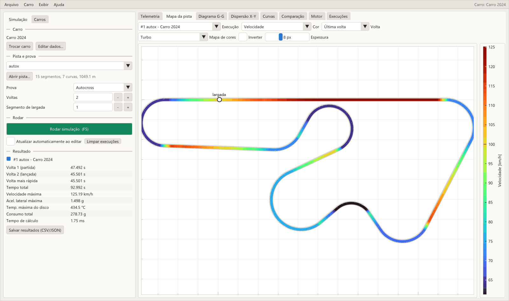
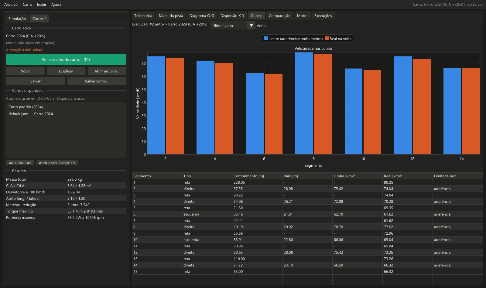

# fsae-lapsim

Simulador de tempo de volta para Formula SAE. Você monta o carro (massa, aerodinâmica,
pneus, motor, câmbio, freio), escolhe a pista e vê em milissegundos o tempo de volta, a
telemetria completa e a comparação entre setups.

O modelo é quase-estático, com:
- transferência de carga entre os pneus e sensibilidade do atrito à carga;
- elipse de atrito em cada eixo: o carro acelera e freia dentro das curvas, dividindo a
  aderência com a força lateral;
- aerodinâmica (downforce e arrasto);
- curva de torque do motor com câmbio, tempo de troca e largada com two-step;
- limite de aderência e de tombamento nas curvas;
- freio nos dois eixos, com distribuição ideal (segue a transferência de carga) ou balanço
  fixo;
- temperatura do disco de freio;
- consumo de combustível por BSFC e endurance com a massa caindo a cada volta.

Há dois modelos: o **melhorado** (padrão, [detalhes](docs/modelo_melhorado.md)) e o
**original**, que reproduz exatamente a versão em MATLAB, de onde o projeto começou.



*English summary: Formula SAE point-mass lap time simulator in C++17, with a desktop GUI
to edit the car, run and plot, and a command-line tool that writes CSV/JSON.*

## Baixar e usar (Windows)

1. Baixe o **`fsae-lapsim-...-windows.zip`** na página da
   **[versão mais recente](https://github.com/rodrigopenat18-ux/fsae-lapsim/releases/latest)**
   (também aparece em *Releases*, na lateral direita desta página).
2. Descompacte em qualquer pasta.
3. Dê duplo clique em **`fsae_gui.exe`**. Não precisa instalar nem compilar nada.
4. Escolha a pista e clique em **Rodar simulação** (F5).

Mantenha a pasta `Data` ao lado do `.exe`: é lá que ficam os carros e as pistas.
Compilar só é necessário para quem quiser alterar o código (seção
[Para desenvolvedores](#para-desenvolvedores)).

## Índice

- [Interface gráfica](#interface-gráfica)
- [Linha de comando](#linha-de-comando)
- [O carro](#o-carro)
- [Pistas](#pistas)
- [Comparar com dados reais](#comparar-com-dados-reais)
- [Para desenvolvedores](#para-desenvolvedores)
- [Estrutura do projeto](#estrutura-do-projeto)
- [Limitações e próximos passos](#limitações-e-próximos-passos)
- [Histórico](#histórico)
- [Autores](#autores)

## Interface gráfica

Abra o `fsae_gui.exe`, seja o do zip baixado ou o da pasta do projeto depois de compilar.
Ele procura a pasta `Data` (carros e pistas) ao seu lado ou nas pastas acima. Se copiar o
`.exe` para outro lugar, leve a pasta `Data` junto ou defina a variável de ambiente
`FSAE_DATA_DIR`.

**Menus.**

- **Arquivo:** novo carro, abrir e salvar carro, abrir pista e salvar os resultados.
- **Carro:** editar os dados e importar curvas.
- **Exibir:** tema claro ou escuro, que fica salvo junto com as outras preferências.
- **Atalhos:** F5 roda a simulação, F2 abre os dados do carro e Ctrl+S salva o carro.

**Painel da esquerda, aba Simulação:**

1. **Carro:** qual está em uso. Os botões levam para a aba Carros ou abrem a edição.
2. **Pista e prova:** escolha uma pista de `Data/Tracks` ou abra qualquer CSV (os formatos
   estão na seção [Pistas](#pistas)), o modelo (melhorado ou original), a prova, o
   número de voltas, o combustível na largada (no endurance a massa cai a cada volta) e o
   segmento de largada.
3. **Rodar:**
   - **Rodar simulação** (F5) guarda uma nova execução. Até 8 ficam guardadas, cada uma
     com sua cor, para comparar setups.
   - **Atualizar automaticamente ao editar** refaz a última execução a cada alteração:
     mude o Cl·A ou uma relação de marcha e veja o tempo mudar na hora.
4. **Resultado:** tempos de volta, máximos e consumo. **Salvar resultados** grava os mesmos
   arquivos da linha de comando (`telemetry.csv`, `summary.json`...).

**Painel da esquerda, aba Carros:**

- **Novo**, **Duplicar** (para testar uma variação sem perder o original), **Abrir
  arquivo...**, **Salvar** e **Salvar como...**.
- A lista dos carros em `Data/Cars`: um clique carrega o carro. Se houver alterações não
  salvas, o programa pergunta antes de trocar.
- Um resumo do carro: massa, Cl·A/Cd·A, downforce a 100 km/h, atrito, marchas, torque e
  potência máximos.

**Dados do carro (F2).** Abre uma janela própria, que você pode mover e redimensionar, com
uma aba por grupo:

| Aba | Conteúdo |
|---|---|
| Geral | nome, massa do carro e do piloto, gravidade |
| Aerodinâmica | área frontal, densidade do ar, Cl·A, Cd·A, centro de pressão, mais Cl, Cd e L/D calculados e o gráfico de downforce e arrasto pela velocidade |
| Chassi e pneus | entre-eixos, raio do pneu, distribuição de peso, CG, bitolas, atritos e sensibilidade do atrito à carga |
| Transmissão | reduções, eficiência, tempo de troca, rpm de largada e de redução, tabela de marchas e o gráfico de rotação × velocidade em cada marcha |
| Motor | tabelas de torque e de BSFC, editáveis ponto a ponto, com os gráficos de torque e potência |
| Freio e ar | torque máximo de freio, distribuição (ideal ou balanço fixo na dianteira) e parâmetros do modelo térmico do disco |

Valores inválidos aparecem em vermelho e bloqueiam a simulação. **Desfazer alterações**
volta ao último estado salvo.



**Importar curvas.** Nas abas Transmissão e Motor (e no menu Carro), **Importar
planilha...** aceita:

- Excel `.xlsx`, escolhendo a planilha;
- CSV ou TXT com separador `,`, `;` ou tabulação, decimal com ponto ou vírgula.

**Colar do Excel** lê o que foi copiado com Ctrl+C.

Na janela de importação:

- escolha as colunas (rpm e torque, rpm e BSFC, ou relação e rpm de subida) e a unidade
  (N·m, kgf·m ou lbf·ft; g/kWh ou lb/(hp·h));
- confira a prévia: a tabela e a curva nova sobre a atual.

Linhas de título acima do cabeçalho e colunas de texto são ignoradas. Rotações repetidas
geram aviso.



**Abas de gráficos.** Em todas dá para escolher a volta (última, todas ou uma
específica), dar zoom com a roda do mouse e arrastar.

| Aba | O que mostra |
|---|---|
| Telemetria | qualquer combinação de canais empilhados (velocidade, acelerações, rpm, marcha, forças, carga, temperatura e calor do disco, combustível) por tempo ou distância, para todas as execuções visíveis |
| Mapa da pista | a pista colorida por qualquer canal. Dá para escolher o mapa de cores (Viridis, Turbo, Plasma, Jet, Hot, Cool, Vermelho-Azul, Espectral, Twilight, Cinzas...), inverter e mudar a espessura; passe o mouse para ler o valor |
| Diagrama G-G | aceleração lateral × longitudinal |
| Dispersão X-Y | qualquer canal contra qualquer outro |
| Curvas | velocidade-limite × velocidade real em cada curva, e a tabela dos segmentos com o que limitou cada curva |
| Comparação | velocidade e diferença de tempo acumulada ao longo da pista, em relação a uma execução de base |
| Motor | torque, potência e BSFC do carro em edição, e rotação × velocidade em cada marcha |
| Execuções | tabela com todas as execuções: renomear, esconder, salvar, remover ou copiar o carro de volta para o editor |







## Linha de comando

O `fsae_sim.exe` faz a mesma simulação sem janela: serve para rodar em lote, em scripts
ou num otimizador.

```bash
fsae_sim run --track autox
```

```
Resultados gravados em Results/autox

----------------------------------------
Pista: autox (autocross, 2 voltas, 1049.05 m por volta)
Modelo: melhorado
Volta 1 (partida):      47.087 s
Volta 2 (lancada):      45.019 s
Volta mais rapida:      45.019 s
Tempo total:            92.106 s
Velocidade maxima:      125.19 km/h
Acel. lateral max.:      1.526 g
Temp. max. freio:        434.1 C
Consumo total:          254.95 g
  consumo volta 1:      131.15 g
  consumo volta 2:      123.80 g
----------------------------------------
```

Outros exemplos:

```bash
fsae_sim run --track skidpad
fsae_sim run --track acceleration --car meu_carro.json --out Results/accel_setupB
fsae_sim run --track autox_2024_v1 --laps 5 --start-segment 10
fsae_sim run --track minha_pista.csv --event custom --verbose
fsae_sim run --track autox --model original           # modelo original (igual ao MATLAB)
fsae_sim run --track autox --event endurance --fuel 4  # 25 voltas, 4 kg de combustível
fsae_sim run --track autox --json --no-files        # resumo em JSON na saída padrão
```

| Comando | O que faz |
|---|---|
| `run --track <pista> [opções]` | simula e grava os resultados |
| `list-tracks` | lista as pistas de `Data/Tracks` |
| `check-track <arquivo>` | valida uma pista e mostra número de segmentos, curvas e comprimento |
| `convert-track <entrada> <saída.csv> [comentário]` | converte uma pista de outro formato (trackExcel/OptimumLap ou matriz de segmentos) para o CSV do projeto |
| `gpx-slope <pista> <arquivo.gpx> <saída.csv>` | preenche a inclinação dos segmentos a partir da altitude de um GPX |
| `print-default-car` | imprime o carro padrão em JSON |
| `check-car <arquivo.json>` | valida um JSON de carro |
| `version`, `help` | versão e ajuda |

Opções do `run`:

| Opção | Padrão | Descrição |
|---|---|---|
| `--track <arquivo\|nome>` | — | CSV da pista ou nome de uma pista de `Data/Tracks` |
| `--car <arquivo.json>` | carro padrão (2024) | carro |
| `--model <modelo>` | `melhorado` | `melhorado` ou `original` (idêntico ao MATLAB) |
| `--event <prova>` | deduzido do nome da pista | `autocross`, `skidpad`, `acceleration`, `endurance` ou `custom` |
| `--laps <n>` | 2 em autocross/custom, 25 no endurance, 1 nas outras | número de voltas seguidas (a 1ª parte parada) |
| `--fuel <kg>` | 0 | combustível no tanque na largada; no modelo melhorado a massa cai a cada volta |
| `--start-segment <k>` | 1 | a volta começa no segmento `k` |
| `--out <pasta>` | `Results/<pista>` | onde gravar os arquivos |
| `--no-files` | — | só mostra o resumo |
| `--json` | — | imprime o `summary.json` na saída padrão (útil para otimizadores) |
| `--verbose` | — | relatório trecho a trecho |
| `--quiet` | — | não imprime o resumo |
| `--repeat <n>` | 1 | roda `n` vezes e mostra o tempo médio de execução |

**Arquivos gravados em `--out`:**

| Arquivo | Conteúdo |
|---|---|
| `telemetry.csv` | uma linha por amostra: `time`, `distance`, `velocity`, `gear`, `acceleration`, `rpm`, `lateral_accel`, forças, `brake_temp`, `fuel_consumed_g`, `P_conv`, `P_rad`, `P_cond`, `load_front_dist` e `lap`. Unidades SI (m/s, m/s², N, W). |
| `summary.json` | tempos, consumo e máximos, total e por volta |
| `track.csv` | segmentos usados (já com o segmento de largada) e a velocidade máxima de cada curva, indicando quando o limite foi tombamento |
| `geometry.csv` | traçado X/Y/Z para gráficos |
| `car.json` | o carro usado |

Os números são gravados na menor forma decimal que reproduz o valor exato, então reler os
arquivos não perde precisão. Para gráficos fora da interface, há um script Python em
[`Root/Python`](Root/Python) (`python Root/Python/plot_results.py Results/autox`).

## O carro

Os carros ficam em [`Data/Cars`](Data/Cars), em JSON. `default.json` é o carro de 2024.
O mais fácil é editar pela interface. Também dá para copiar o arquivo, mudar os números e
usar com `--car`.

Os valores entram nas unidades em que costumam ser medidos, e a unidade faz parte do nome
(`cg_height_m`, `tire_radius_mm`, `shift_time_ms`, `cl_a_m2`). Grupos: `mass`, `aero`,
`chassis`, `tyre`, `powertrain`, `engine` (curvas de torque e BSFC), `brakes` e `air`.

A leitura é rigorosa: campo com nome errado, campo faltando, texto no lugar de número,
número de marchas diferente do número de rpm de troca, massa negativa etc. geram erro
com o caminho do campo, por exemplo:

```
Erro: JSON do carro: chassis.cg_heigth_m: campo desconhecido (validos: wheelbase_m, tire_radius_mm, ...)
```

## Pistas

Pistas são listas de segmentos (reta ou curva à esquerda/direita, com comprimento, raio e
inclinação). As que acompanham o projeto ficam em [`Data/Tracks`](Data/Tracks):

| Arquivo | Pista |
|---|---|
| `autox.csv` | autocross, 15 segmentos, 1.049 m |
| `autox_2024_v1.csv` | autocross 2024, com inclinação, 960 m |
| `autox_2024_v1_reversed.csv` | a mesma no sentido inverso |
| `skidpad.csv` | 5 m de entrada + uma volta de 8,2 m de raio |
| `acceleration.csv` | reta de 75 m |

Três formatos são aceitos, detectados automaticamente:

1. **CSV do projeto** (comentários com `#`):
   ```
   length_m,radius_m,slope,type
   228.05,0,0,straight
   57.551087148523706,28.08,0,right
   ```
2. **Matriz de segmentos** (`index,length,radius,slope,type`, com `type` 0 reta,
   1 esquerda, 2 direita):
   ```
   index,length,radius,slope,type
   1,228.05,0,0,0
   2,57.551087148523706,28.08,0,2
   ```
3. **trackExcel / OptimumLap**: `Tipo;Comprimento;Raio`, sem cabeçalho, inclinação zero.
   ```
   Left;1;83.875
   Straight;2.12;0
   ```

Erros apontam a linha (`Pista X, linha 12: curva (left/right) precisa de raio maior que 0`).

**Inclinação por GPX.** Com uma caminhada da pista gravada em GPX, rode
`fsae_sim gpx-slope pista.csv caminhada.gpx pista_com_slope.csv`. O programa:

1. suaviza a altitude;
2. acompanha o GPX pela distância percorrida;
3. interpola a altitude no início e no fim de cada segmento;
4. distribui o erro de fechamento da volta;
5. grava `atan(Δz/L)` em radianos.

O GPX precisa começar na largada e seguir o mesmo sentido dos segmentos.

## Comparar com dados reais

```bash
python Root/Python/plot_results.py Results/autox --log log_autox.csv
python Root/Python/plot_results.py Results/accel --log log_acceleration.csv --oplap Pista_Accel_OPLap.csv
```

Mostra velocidade, rpm, acelerações e marcha da simulação sobre o log de aquisição e/ou a
exportação do OptimumLap. Guarde esses arquivos em `Data/Private`, que não vai para o Git.

O log de aquisição é um CSV com cabeçalho. As colunas são reconhecidas pelo início do nome,
sem diferenciar maiúsculas nem acentos:

| Grandeza | Coluna começa com | Unidade |
|---|---|---|
| tempo | `TIME`, `TEMPO` | s |
| velocidade | `VELOCIDADE` | km/h |
| rpm | `RPM` | rpm |
| marcha | `MARCHA`, `Gear` | — |
| aceleração longitudinal | `Força_G_acelera`, `ACELERACAO_LONGITUDINAL` | g |
| aceleração lateral | `Força_G_lateral`, `ACELERACAO_LATERAL` | g |
| distância (opcional) | `DISTANCIA`, `Distance` | m |

A exportação do OptimumLap é lida a partir da seção `[Simulation Results]`.

## Para desenvolvedores

### Compilar

Requisitos: compilador C++17, CMake ≥ 3.20 e Ninja. Na primeira compilação o CMake baixa
as bibliotecas usadas, então é preciso internet:

- [nlohmann/json](https://github.com/nlohmann/json), para o JSON do carro;
- [miniz](https://github.com/richgel999/miniz), para ler planilhas do Excel;
- [doctest](https://github.com/doctest/doctest), para os testes;
- [GLFW](https://www.glfw.org), [Dear ImGui](https://github.com/ocornut/imgui) e
  [ImPlot](https://github.com/epezent/implot), para a interface.

**Windows (MSYS2):**

```bash
winget install --id MSYS2.MSYS2 -e --source winget
```

No terminal **MSYS2 UCRT64**:

```bash
pacman -S --needed mingw-w64-ucrt-x86_64-gcc mingw-w64-ucrt-x86_64-cmake mingw-w64-ucrt-x86_64-ninja
```

Depois, adicione `C:\msys64\ucrt64\bin` ao PATH do Windows (ou rode os comandos abaixo no
próprio terminal UCRT64). Os executáveis gerados são estáticos: rodam em qualquer Windows
sem o MSYS2.

O código é C++ padrão. Em Linux e macOS basta instalar `cmake`, `ninja` e um compilador
(no Linux, também os pacotes de desenvolvimento do OpenGL/X11 para a interface).

```bash
cmake --preset release
cmake --build --preset release
ctest --preset release
```

Depois de compilar, **`fsae_gui.exe` e `fsae_sim.exe` aparecem na própria pasta do
projeto**, ao lado de `Data/`: é só dar duplo clique. Essas cópias não vão para o Git; os
originais ficam em `build/release/Root/`.

### Testes

`ctest` roda os testes de [`Tests/`](Tests). Eles comparam cada parte do simulador (e as
voltas completas) com resultados de referência, então qualquer mudança que altere um
número sem querer é detectada. Mudanças de física devem entrar como opção (ver
[CONTRIBUTING.md](CONTRIBUTING.md)).

### Usar como biblioteca

A física está na biblioteca `fsae::core` ([`Modules/`](Modules)), separada dos programas:

```cpp
#include "IO_Tools/car_json.hpp"
#include "Simulation/lap.hpp"
#include "Tracks/track.hpp"

const fsae::Car car = fsae::io::load_car("meu_carro.json");
const auto track = fsae::track::load_track("Data/Tracks/autox.csv");
fsae::sim::SimulationOptions opt;
opt.laps = 2;
opt.solver = fsae::sim::Solver::QuasiStatic;  // modelo melhorado (o padrão da biblioteca é o original)
const auto r = fsae::sim::simulate(car, track.segments, opt);
// r.lap_times, r.total_time, r.history.velocity, ...
```

Com `add_subdirectory` ou `FetchContent` no CMake, ligue a `fsae::core` (use
`-DFSAE_BUILD_TESTS=OFF -DFSAE_BUILD_APPS=OFF -DFSAE_BUILD_GUI=OFF` para compilar só a
biblioteca).

## Estrutura do projeto

```
Data/              carros e pistas
  Cars/            carros (.json)
  Tracks/          pistas (.csv)
  Private/         seus logs, GPX, OptimumLap...; só no seu computador, fora do Git
Modules/           o simulador (biblioteca fsae::core)
  Vehicle/         parâmetros do carro e mapas do motor
  Physics/         forças, cargas nos pneus, motor/freio, temperatura do disco, passo de tempo
  Control/         câmbio: marcha inicial, subida, redução, tempo de troca
  Tracks/          pistas, velocidade máxima de curva, traçado, GPX
  Simulation/      reta e volta completa
  IO_Tools/        leitura e gravação: JSON do carro, CSV, planilhas Excel, resultados
  Math/            interpolação
Root/              os programas
  GUI/             fsae_gui: a interface gráfica
  CLI/             fsae_sim: linha de comando
  Python/          plot_results.py: gráficos e comparação com logs, opcional
Tests/             testes automáticos
MATLAB/            histórico: a versão original em MATLAB, guardada para consulta
docs/              problemas conhecidos do modelo e imagens
```

Cada pasta tem um `README.md` curto explicando o que há dentro. A pasta `build/` aparece
depois de compilar; ela não vai para o Git e pode ser apagada a qualquer momento.

## Limitações e próximos passos

O modelo melhorado é quase-estático: não há dinâmica de guinada nem de rolagem, e o BSFC
é o de plena carga também em carga parcial ([detalhes](docs/modelo_melhorado.md)). O
modelo original tem as simplificações e os comportamentos listados em
[problemas conhecidos](docs/problemas_conhecidos.md), cada um com a correção e o efeito
medido.

Planejado:

- integração com otimizadores (modeFRONTIER) usando `--json`;
- troca de piloto no endurance.

## Histórico

O simulador começou em MATLAB e foi reescrito em C++ para ficar mais rápido e mais fácil
de usar. O modelo original reproduz exatamente os resultados da versão em MATLAB. A versão
original e o material usado na conversão estão guardados em [`MATLAB/`](MATLAB), só para
consulta.

## Autores

- **Rodrigo Pena**: desenvolvimento
- **Gabriel Marques**: desenvolvimento
- **Caio Cramer**: orientação

Para citar em trabalhos acadêmicos, use o botão *Cite this repository* do GitHub (arquivo
[`CITATION.cff`](CITATION.cff)).

## Licença

MIT — veja [LICENSE](LICENSE).
